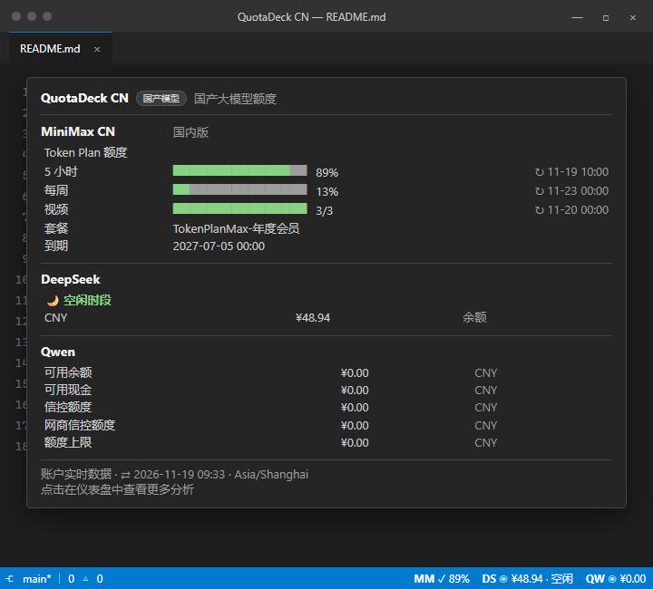
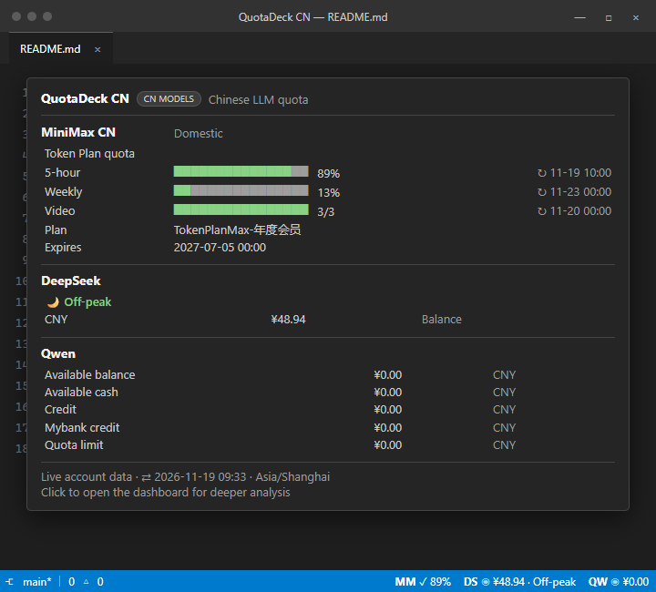
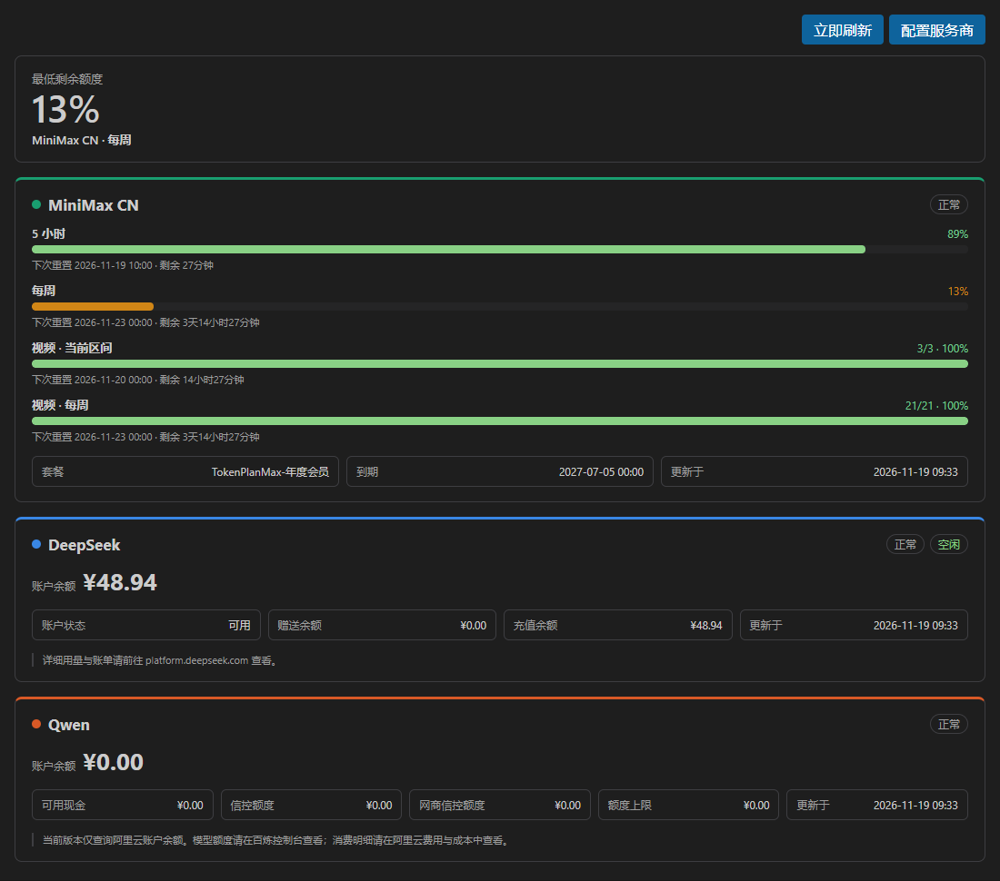
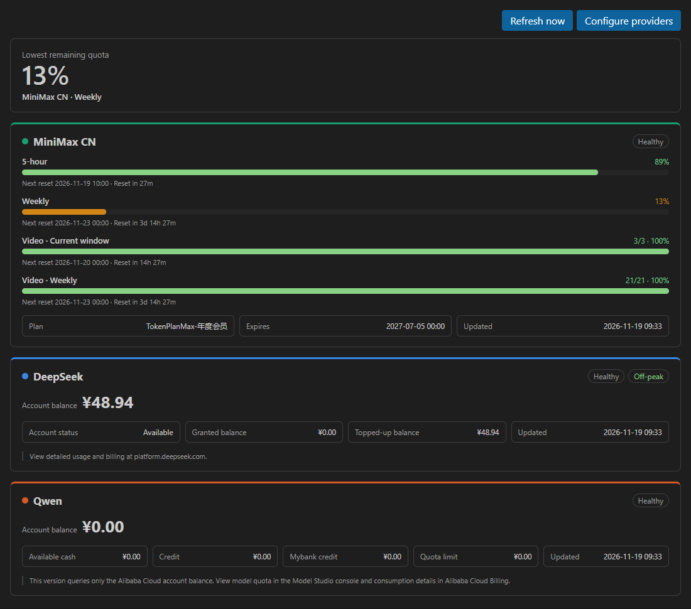
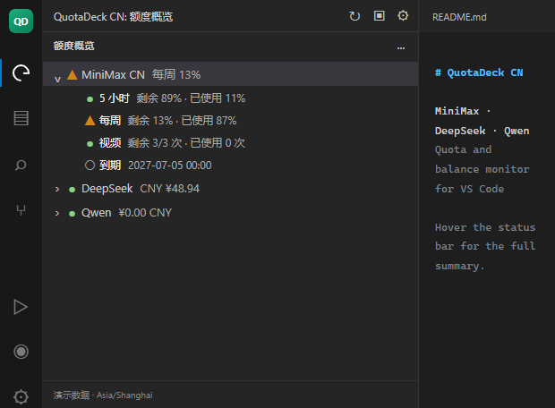
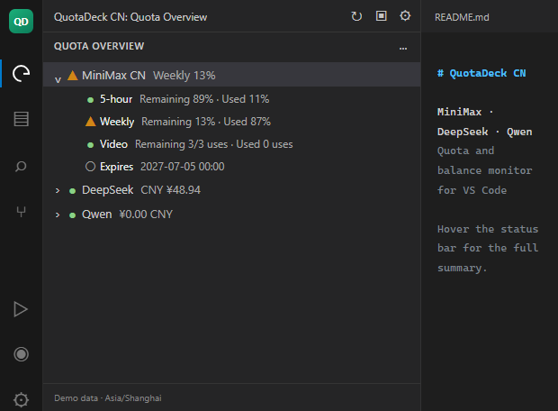

# QuotaDeck CN

**在 VS Code 状态栏查看 MiniMax、DeepSeek、Qwen 的余额与 Token Plan 额度窗口。**

不用在三个厂商控制台之间来回切换。QuotaDeck CN 把已配置账户的实时摘要放在编辑器里；悬停查看完整信息，需要明细时再打开可选仪表盘。

[Visual Studio Marketplace](https://marketplace.visualstudio.com/items?itemName=alexmultiagent.quota-deck) · [问题反馈](https://github.com/AlexMultiAgent/VSC-plugin-quota-deck/issues) · [⭐ Star](https://github.com/AlexMultiAgent/VSC-plugin-quota-deck) · [MIT](LICENSE) · 无遥测

## 预览

以下截图使用演示数据。

| 状态栏与悬停详情 | English |
|---|---|
|  |  |

| 仪表盘 | English |
|---|---|
|  |  |

| Activity Bar 额度概览 | English |
|---|---|
|  |  |

## 安装

在 VS Code Marketplace 搜索 **QuotaDeck CN**，或运行：

```bash
code --install-extension alexmultiagent.quota-deck
```

也可从 [Visual Studio Marketplace](https://marketplace.visualstudio.com/items?itemName=alexmultiagent.quota-deck)
下载 VSIX，再执行 `code --install-extension quota-deck-<version>.vsix`。

## 开始使用

1. 点击左侧 Activity Bar 的 QuotaDeck 入口，或状态栏中的额度摘要。
2. 选择 MiniMax CN、MiniMax Global、DeepSeek 或 Qwen，按提示登录或填入对应凭据。
3. 回到编辑器，已配置服务商的余额、额度窗口和重置倒计时会自动显示。

凭据只保存在 VS Code Secret Storage，不写入 `settings.json`，也不会回显到设置页或日志。

## 支持范围

| 服务商 | 展示内容 | 所需凭据 |
|---|---|---|
| MiniMax CN / Global | 5 小时与每周额度、视频剩余次数、套餐信息、声音槽位、续费价格、每周额度倍数、账户余额（现金/代金券/信用/欠费）、重置倒计时 | Token Plan Key |
| DeepSeek | 按币种展示余额、赠送/充值余额、忙时/闲时状态 | API Key |
| Qwen / 百炼 | 千问AI平台账户余额（可用余额/现金/信控额度/可用信控/额度上限/已用额度/未结清/未支付/账户状态）；个人 Token Plan 额度、重置时间、套餐、到期、剩余天数、开始时间、自动续费 | 千问AI平台设备码登录（余额与 Token Plan 共用） |

Qwen 通过一次千问AI平台设备码登录同时查询账户余额和个人 Token Plan 额度；模型级额度与消费明细仍在对应控制台查看。

### English quick start

QuotaDeck CN keeps MiniMax, DeepSeek, and Qwen account data in your VS Code status bar. Open the QuotaDeck Activity Bar view or status bar item, choose a provider, and enter its credential. Configured providers refresh automatically; hover for the full summary or open the optional dashboard for account details. Credentials stay in VS Code Secret Storage. Qwen signs in to Qianwen AI once to report the account balance and the personal Token Plan quota; model-level quota remains in the console.

## Features

- 状态栏显示各服务商的剩余额度与余额，MiniMax 并排标注 5 小时与每周窗口；DeepSeek 同时标注忙时或闲时。重置倒计时保留在悬停详情、Activity Bar 与仪表盘。
- 状态栏只显示已配置的服务商，避免未配置项占据空间。
- 状态栏默认每 5 分钟自动刷新；可在仪表盘“立即刷新”或命令面板手动刷新。
- 单击状态栏打开仪表盘时会立即重新获取数据，并同步刷新状态栏、悬浮详情和仪表盘。
- 额度按剩余比例使用绿色、橙色、红色三阶段文字，仅剩余 5% 及以下使用红色警示背景。
- Qwen 同时显示账户余额与千问AI平台 Token Plan 窗口；两者共用登录令牌，查询失败时独立降级。悬浮详情只保留账户余额和 Token Plan 摘要，现金/信控/额度上限等明细在仪表盘和 Activity Bar 中查看。
- MiniMax 展示套餐、声音槽位、续费价格与账户余额（可用/现金/代金券/信用/欠费）；控制台积分仅支持 Cookie 会话，API key 无法读取，插件改为提示前往控制台查看；无限额度窗口在四个界面统一显示为“无限”，不会显示为 0% 或“—”；每周额度会应用平台的放大系数。
- 历史用量区间只作用于 MiniMax Token 用量，并与实时额度窗口分开显示；没有实际消费记录时不展示范围筛选。
- 悬停提示展示完整摘要，并标注账户实时数据来源；不会重复展示 API Key / AccessKey 等凭据类型。
- 左侧 Activity Bar 提供额度概览：展开查看各服务商明细，点击服务商打开完整仪表盘；标题栏可刷新、打开仪表盘或进入插件设置。
- 可选仪表盘：最低实时额度、额度重置、当前账户明细、MiniMax 套餐与可用历史用量，并提供刷新和配置入口。
- MiniMax 国内版与国际版账号独立配置。
- DeepSeek 官方余额查询；详细用量与账单请前往 DeepSeek 官网。
- 取数失败时保留上一次的数据并标注“数据已过期”，而不是显示为未配置。
- “检查连接”命令会先刷新，再在输出面板列出每个服务商的凭据状态、上次刷新时间和各 capability 状态。
- 凭据只保存在 VS Code Secret Storage。
- 简体中文与英文界面。
- 时间默认跟随操作系统时区（`quotaDeck.timeZone` 为 `auto`）；可执行 `QuotaDeck CN: 选择时区` / `Pick Time Zone` 从带 UTC 偏移与当地时刻的列表中挑选，也可直接填写任意 IANA 时区。金额默认使用人民币格式。

## Configure

1. 点击左侧 Activity Bar 或状态栏的 QuotaDeck 图标。新安装可从额度概览直接进入配置流程；已配置后可展开明细或打开仪表盘。
2. 在仪表盘点击“配置服务商”，或在命令面板搜索 `QuotaDeck CN: 配置服务商` / `Configure Providers`。
3. 选择 MiniMax CN、MiniMax Global、DeepSeek 或 Qwen，输入对应凭据。
4. 再次点击状态栏图标查看额度。

DeepSeek 凭据获取方式：

- **API 密钥**：登录 `https://platform.deepseek.com`，进入 `API Keys` 创建并复制。

只配置 API 密钥即可查询余额。插件不请求 DeepSeek 平台会话令牌或 Cookie，
详细用量、费用和账户汇总请前往 DeepSeek 官网查看。已有凭据会以掩码形式预填；
直接按 `Enter` 保留，按 `Ctrl+A` 后可重新输入并替换。

DeepSeek 忙时/闲时按官方规则判断：

- 忙时为 UTC 周一至周五 `01:00–04:00` 和 `06:00–10:00`，即北京时间
  周一至周五 `09:00–12:00` 和 `14:00–18:00`。
- 其他时段、周末和中国法定节假日全天均为闲时。
- 状态栏、悬浮详情和仪表盘共享同一次刷新算出的时段状态。

Qwen / 百炼余额与 Token Plan 获取方式：

- 执行 `QuotaDeck CN: 登录千问AI平台`，在浏览器完成设备码登录。同一令牌同时查询账户余额和
  个人 Token Plan 额度；令牌只保存在 VS Code Secret Storage，过期后重新登录即可。
- 不再需要阿里云 AccessKey。旧版 AccessKey 会在登录成功后删除，也可通过
  `QuotaDeck CN: Clear Credential` 手动清除。
- 扩展显示可用余额、可用现金、信控额度、额度上限，以及 Token Plan 的月度/每周
  剩余比例、重置时间、套餐档位和到期时间。
- 登录使用千问AI平台的官方管理接口，不读取浏览器 Cookie，也不需要阿里云 AccessKey 的
  工作空间授权。
- 模型级额度与消费明细仍需在千问AI平台/百炼控制台查看；消费账单需要单独的 BSS 账单 API、
  额外权限和分页处理，因此不会用账户余额或本地估算值代替。
- 官方 Usage API（`/usage/summary`、`/usage/trend`）和 `bl quota show` CLI 仍登记为候选数据源，
  尚未完成鉴权、响应字段和分页契约验证；详见
  [Qwen / Model Studio contract inventory](docs/contracts/qwen.md)。

警告阈值可在 VS Code 设置中搜索 `QuotaDeck warning threshold`，或直接设置
`quotaDeck.statusBar.warningThresholdPercent`。默认值为 `20`，支持 `11` 到 `99`；
剩余额度严格低于该值时显示橙色警告，低于或等于 `5%` 时显示红色严重警告，其余保持绿色。
该阈值作用于插件展示的每一个百分比：MiniMax 的 5 小时与每周窗口，以及 Qwen Token Plan 的
月度/每周窗口；DeepSeek 余额与 Qwen 账户余额是金额而非百分比，因此不适用。

额度窗口、重置倒计时与用量区间按 `quotaDeck.timeZone` 指定的时区计算，默认 `auto`，即跟随
操作系统时区；无法识别的取值同样回退到系统时区。修改设置后立即生效，无需重启窗口。

凭据通过密码输入框填写，不会回显，也不会写入 settings、全局状态或日志。
重新配置会覆盖已保存的值；若要彻底删除某个凭据，执行 `QuotaDeck CN: Clear Credential`
并从列表中选择要清除的那一项。

## Privacy

扩展不采集遥测。除下列固定域名外，扩展不发起网络请求：

| 主机 | 用途 |
|---|---|
| `www.minimaxi.com` | MiniMax 国内账户 |
| `www.minimax.io` | MiniMax 国际账户 |
| `api.deepseek.com` | DeepSeek 余额 |
| `t.qianwenai.com` | 千问AI平台设备码登录 |
| `cli.qianwenai.com` | 千问账户余额、登录令牌与控制台令牌 |
| `cs-data.qianwenai.com` | 千问 Token Plan 额度与订阅 |

账户响应进入展示层前会被规范化和 HTML 转义；提交后的 fixture 还会经过凭据形状与财务金额匿名化检查。

## Commands

| Command | 说明 |
|---|---|
| `QuotaDeck CN: Open Dashboard` | 打开仪表盘 |
| `QuotaDeck CN: Refresh` | 立即刷新 |
| `QuotaDeck CN: Switch Provider` | 切换主服务商 |
| `QuotaDeck CN: Configure MiniMax` | 配置 MiniMax 国内版或国际版 |
| `QuotaDeck CN: Configure DeepSeek` | 配置 DeepSeek |
| `QuotaDeck CN: 登录千问AI平台` | 设备码登录，查询账户余额与个人 Token Plan 额度 |
| `QuotaDeck CN: Configure Providers` | 从仪表盘之外统一打开配置流程 |
| `QuotaDeck CN: Extension Settings` | 打开本插件的原生设置页 |
| `QuotaDeck CN: 选择时区` | 从 IANA 时区列表中挑选，或恢复跟随操作系统时区 |
| `QuotaDeck CN: Clear Credential` | 清除已保存的凭据 |
| `QuotaDeck CN: 检查连接` | 先刷新，再在输出面板列出凭据、上次刷新时间和各能力状态 |
| `QuotaDeck CN: Show Help` | 查看帮助 |

## Known limitations

- MiniMax 的部分账户接口不是稳定的公共开发者 API，平台调整后可能暂时返回“不支持”或“获取失败”。
- DeepSeek 仅提供账户余额；详细用量与账单需前往 DeepSeek 官网。
- Qwen 余额与 Token Plan 额度均来自千问AI平台未公开的管理网关，平台调整后可能暂时返回
  “获取失败”；登录过期时两者同时不可用。模型级额度与消费明细需前往千问AI平台/百炼控制台查看。
- DeepSeek 节假日日历目前覆盖至 `2026-12-31`，超出覆盖范围时显示“时段未知”。
- 不代理模型请求，不提供对话补全，也不把本地估算当成账户余额或官方额度。
- 不请求或保存网页 Cookie，不做货币换算，也不合并不同币种的金额。

## 相关发布

| 渠道 | 用途 |
| --- | --- |
| [VS Code Marketplace](https://marketplace.visualstudio.com/items?itemName=alexmultiagent.quota-deck) | 安装扩展（VS Code、Cursor、Windsurf 等 VS Code 兼容编辑器） |
| [GitHub Releases](https://github.com/AlexMultiAgent/VSC-plugin-quota-deck/releases) | 下载 VSIX，适用于离线安装或手动更新 |
| [MCP server 源码](https://github.com/AlexMultiAgent/VSC-plugin-quota-deck/tree/main/mcp) | 在 Claude Code 等 MCP 客户端查询同一份额度；当前从源码构建，npm 发布为后续可选项 |

## 支持这个项目

如果 QuotaDeck 帮到了你，欢迎在 [GitHub 点个 Star ⭐](https://github.com/AlexMultiAgent/VSC-plugin-quota-deck)，这对我们意义重大。

If QuotaDeck has been useful to you, please consider [starring it on GitHub ⭐](https://github.com/AlexMultiAgent/VSC-plugin-quota-deck) — it means a lot to us.

## License

MIT
